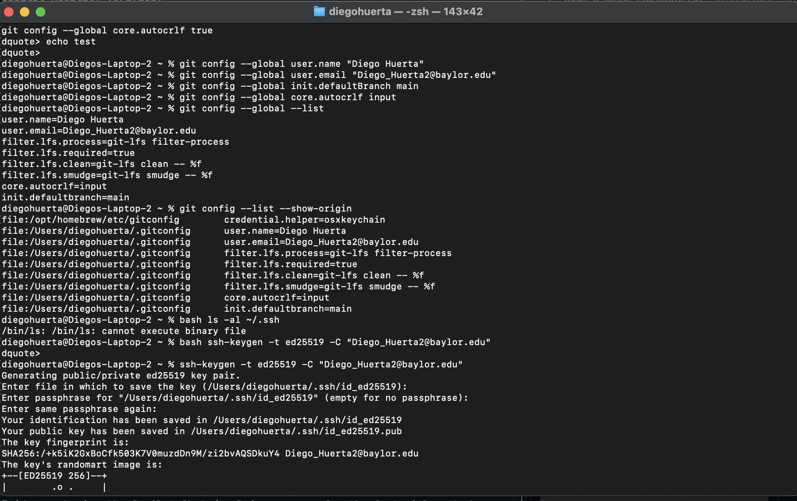

Lab 09 Verification Report

Student Name: Diego Huerta
BearID: 892827945
GitHub Username: Jldian
Date: October 20, 2026

1. Tooling Verification

Git Version:

git version 2.53.0

Global Git Configuration:

user.name=Diego Huerta
user.email=Diego_Huerta2@baylor.edu

Copilot Modality Verified:

* Inline Completion (Ghost Text)
* GitHub Copilot Chat

2. Evidence Screenshots

Screenshot 1: Git Authentication Test

Evidence of successful SSH authentication using:

ssh -T git@github.com

Screenshot 2: GitHub Copilot Status

Evidence showing GitHub Copilot enabled inside IntelliJ IDEA.

[Insert Screenshot Here]

Screenshot 3: Inline Ghost Text Suggestion

Evidence showing GitHub Copilot suggesting a factorial method in gray text before accepting the suggestion.

Screenshot 4: GitHub Copilot Chat Explanation

Evidence showing the Copilot Chat /explain response for the factorial method.

[Insert Screenshot Here]